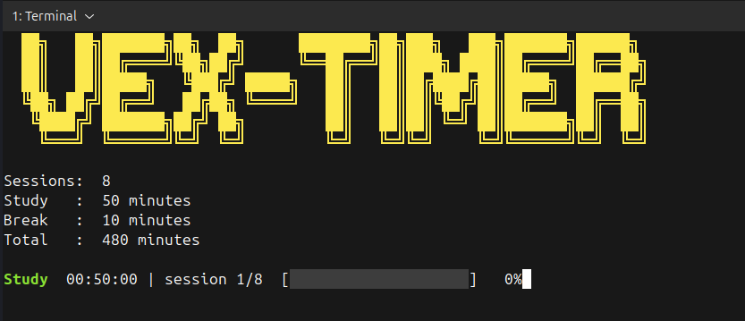

# Vex CLI Study Timer ⏱

<p align="center">
  
</p>

<p align="center">
  <a href="https://github.com/E-Vex/vex-cli-study-timer/releases/latest">
    
  </a>
  <a href="LICENSE">
    
  </a>
  <a href="https://github.com/E-Vex/vex-cli-study-timer/actions/workflows/ci.yml">
    
  </a>
  <a href="https://github.com/E-Vex/vex-cli-study-timer/actions/workflows/release.yml">
    
  </a>
</p>

A small command-line study timer written in C. It schedules focus sessions and
breaks, draws a live progress display, and plays a synthesized chiptune alarm.

Each phase is driven by an absolute monotonic deadline using
`clock_gettime(CLOCK_MONOTONIC)`, so delayed renders or interrupted sleeps do
not make the countdown drift.

## Install

Prebuilt Linux binaries and packages are attached to every
[GitHub release](https://github.com/E-Vex/vex-cli-study-timer/releases), so
you can download and run the timer without cloning or building anything.
Each release offers the assets below for both **x86_64** and **arm64**, plus
a `SHA256SUMS` file to verify the downloads.

| Asset | Use it when you want to ... |
| --- | --- |
| `vex-timer-<version>-linux-<arch>.AppImage` | Run anywhere without installing; single file |
| `vex-timer_<version>_<debarch>.deb` | Install on Debian, Ubuntu, Mint, Pop!_OS, ... |
| `vex-timer-<version>-1.<rpmarch>.rpm` | Install on Fedora, RHEL, openSUSE, ... |
| `vex-timer-<version>-linux-<arch>.tar.gz` | Unpack a binary + manual page anywhere, optionally install to `/usr/local` |
| `vex-timer-<version>-linux-<arch>` | Script a direct download of the bare binary |

The shipped binaries are statically linked, so they have no shared-library
dependencies and run on any Linux distribution. `aplay` (alsa-utils) and
`notify-send` (libnotify-bin) remain optional runtime helpers for sound and
desktop notifications.

**AppImage** - download, make it executable, run:

```bash
chmod +x vex-timer-1.4.0-linux-x86_64.AppImage
./vex-timer-1.4.0-linux-x86_64.AppImage -s 4 -t 25 -b 5
```

**Debian / Ubuntu and derivatives:**

```bash
sudo apt install ./vex-timer_1.4.0_amd64.deb
vex-timer -s 4 -t 25 -b 5
```

**Fedora / RHEL / openSUSE and derivatives:**

```bash
sudo dnf install ./vex-timer-1.4.0-1.x86_64.rpm
vex-timer -s 4 -t 25 -b 5
```

(older rpm distributions accept `sudo rpm -i vex-timer-1.4.0-1.x86_64.rpm`)

**Portable tarball** - extract and run immediately, with an optional
system-wide install:

```bash
tar -xzf vex-timer-1.4.0-linux-x86_64.tar.gz
cd vex-timer-1.4.0-linux-x86_64
./vex-timer -s 4 -t 25 -b 5

# optional: install the binary and the manual page
sudo install -m 755 vex-timer /usr/local/bin/vex-timer
sudo install -m 644 share/man/man1/vex-timer.1.gz /usr/share/man/man1/
```

Verify a download against the release's `SHA256SUMS` file with
`sha256sum -c --ignore-missing SHA256SUMS`. See [docs/RELEASE.md](docs/RELEASE.md)
for how these artifacts are built and published.

## Features

- Configurable study sessions, focus duration, and break duration
- Optional long breaks on a configurable cadence
- Pause, resume, skip, and quit controls
- Selectable chiptune alarms, with a silent option
- Desktop notifications when `notify-send` is available
- Live countdown, progress bar, and session counter
- Drift-resistant monotonic timing
- ANSI-colored display that honors `NO_COLOR` and `dumb` terminals, and turns
  itself off automatically when stdout is not a terminal
- Strict CLI parsing with clear error messages and exit codes, including the
  `--name=value` form for long options
- Terminal-bell fallback when `aplay` is unavailable or stdin is not a terminal
- Unit tests (`make test`) and GitHub Actions CI

## Requirements

- A POSIX system with a C11 compiler (Linux is the primary target)
- GCC or Clang and `make`
- `aplay` from `alsa-utils` for sound on Linux (optional)
- `notify-send` for desktop notifications (optional)
- A terminal that supports ANSI escape sequences for the live display and
  keyboard controls

CI builds and tests the timer on Linux with GCC and Clang, and on macOS with
Clang. Audio playback uses `aplay`, so sound is Linux-only. Release builds
are statically linked and produced for Linux x86_64 and arm64 by the
release workflow; see [docs/RELEASE.md](docs/RELEASE.md).

## Build

```bash
make
```

Run `make clean` to remove build artifacts, or `make rebuild` to start fresh.

Install the binary and the `vex-timer(1)` manual page onto your system with
`make install` (defaults to `/usr/local`; override with `PREFIX=...`, or
`DESTDIR=...` for staged packaging). `make uninstall` removes both again.

You can also compile manually:

```bash
gcc -Wall -Wextra -std=c11 -O2 -I. \
  src/main.c src/cli/cli.c src/input/input.c src/timer/counter.c \
  src/timer/timer.c src/timer/print.c src/timer/alarm.c sounds/tone.c \
  -lm -o vex-timer
```

## Usage

```bash
./vex-timer -s 4 -t 25 -b 5
```

| Option | Long form | Description | Range |
| --- | --- | --- | --- |
| `-s` | `--sessions` | Number of study sessions | 1-255 |
| `-t` | `--focus` | Focus duration in minutes | 1-255 |
| `-b` | `--break` | Break duration in minutes | 1-255 |
| `-l` | `--long-break` | Long break duration in minutes | 1-255 |
| `-r` | `--long-break-every` | Long break after every N sessions (requires `-l`) | 1-255 |
| `-a` | `--alarm` | Alarm sound (default: `megalovania`) | see below |
| | `--no-notify` | Disable desktop notifications | - |
| `-h` | `--help` | Show help and exit | - |
| `-v` | `--version` | Show version and exit | - |

`-s`, `-t`, and `-b` are required. Long options also accept the `--name=value`
form, for example `--focus=25` or `--alarm=tetris`. Example configurations:

```bash
# Four 25-minute focus sessions with 5-minute breaks
./vex-timer -s 4 -t 25 -b 5

# Same schedule using long options
./vex-timer --sessions 4 --focus 25 --break 5

# Classic Pomodoro: a 15-minute break after every fourth session
./vex-timer -s 8 -t 25 -b 5 -l 15 -r 4

# Same thing with the --name=value form
./vex-timer --sessions=8 --focus=25 --break=5 --long-break=15

# Use the Tetris theme for alarms
./vex-timer -s 4 -t 25 -b 5 -a tetris

# A single 50-minute focus session with no sound or notifications
./vex-timer -s 1 -t 50 -b 1 -a none --no-notify
```

For the first example, the timer shows:

```text
Sessions:  4
Study   :  25 minutes
Break   :  5 minutes
Total   :  115 minutes
```

`Total` counts the three breaks between the four sessions, not a break after
the final session. Long breaks follow the same rule: one runs after every
N-th session (N from `-r`, default 4), but never after the last session. With
`-s 8 -t 25 -b 5 -l 15 -r 4` the header reads:

```text
Sessions:  8
Study   :  25 minutes
Break   :  5 minutes
Long    :  15 minutes every 4 sessions
Total   :  245 minutes
```

## Alarm sounds

| Name | Description |
| --- | --- |
| `megalovania` | Default looping chiptune alarm |
| `remix` | Faster Megalovania remix |
| `jazz` | Swing-jazz variation |
| `call-response` | Call-and-response variation |
| `pvz` | Oom-pah style variation |
| `tetris` | Tetris theme |
| `mario` | Mario theme |
| `imperial` | Imperial March |
| `addictive` | Looping melodic hook |
| `beep` | Short three-note beep |
| `hard-to-say-goodbye` | Slower emotional melody |
| `cinematic` | Ambient cinematic track |
| `garden-guardian` | Gentle garden theme |
| `final-showdown` | Epic showdown theme |
| `victory` | Victory fanfare |
| `none` | Silent; also skips the finish fanfare |

In an interactive terminal, phase alarms repeat until a key is pressed. If
`aplay` is unavailable, the timer falls back to the terminal bell. When stdin
is redirected, a single bell is used so the timer can continue unattended.

## Controls

- **Space** or **P** pauses or resumes the current phase.
- **S** skips the current phase. The phase is counted as completed.
- **Q** quits immediately with exit status `130`.
- **Any key** stops a ringing alarm or the finish fanfare.
- **Ctrl+C** quits immediately with exit status `130`.

Controls require an interactive terminal. When stdin is redirected, the timer
still runs but keyboard controls are unavailable and phase alarms use the
terminal bell.

## How It Works

1. `src/cli/cli.c` validates the command-line arguments and builds a
   `timer_config_t`.
2. `src/input/input.c` puts the terminal into non-canonical mode so key presses
   arrive immediately, and restores the previous terminal settings on exit or
   signal.
3. Each focus or break phase stores an absolute `CLOCK_MONOTONIC` deadline.
4. `vext_counter_v2()` calculates the remaining time from the deadline, updates
   the display once per second, and waits for either the next displayed second
   or a key press.
5. Pausing freezes the remaining nanoseconds; resuming rebuilds the deadline
   from that value. Skipping returns control to the state machine immediately.
6. `src/timer/timer.c` runs the study/break state machine, swapping in a long
   break on the configured cadence, until all sessions are complete or the
   user quits.
7. `sounds/tone.c` synthesizes the selected alarm samples and pipes them to
   `aplay`.
8. `src/notify/notify.c` sends a desktop notification through `notify-send`
   when a phase completes, if the helper is installed.

## Project Structure

```text
vex-cli-study-timer/
├── .github/
│   └── workflows/
│       ├── ci.yml
│       └── release.yml
├── assets/
│   └── demo.png
├── docs/
│   ├── RELEASE.md
│   └── vex-timer.1
├── packaging/
│   ├── appimage/
│   │   ├── AppRun
│   │   ├── vex-timer.desktop
│   │   └── vex-timer.svg
│   ├── deb/
│   │   ├── control.in
│   │   └── copyright
│   ├── rpm/
│   │   └── vex-timer.spec.in
│   └── tarball/
│       └── INSTALL.txt.in
├── sounds/
│   ├── tone.c
│   └── tone.h
├── src/
│   ├── main.c
│   ├── version.h
│   ├── cli/
│   │   ├── cli.c
│   │   └── cli.h
│   ├── input/
│   │   ├── input.c
│   │   └── input.h
│   ├── notify/
│   │   ├── notify.c
│   │   └── notify.h
│   └── timer/
│       ├── alarm.c
│       ├── alarm.h
│       ├── counter.c
│       ├── counter.h
│       ├── internals/
│       │   ├── nanosleep_syscall_diagram.txt
│       │   └── syscall_execution_flow.txt
│       ├── print.c
│       ├── print.h
│       ├── timer.c
│       └── timer.h
├── tests/
│   ├── test_cli.c
│   ├── test_main.c
│   ├── test_notify.c
│   ├── test_timer.c
│   └── test_util.h
├── CHANGELOG.md
├── LICENSE
├── Makefile
└── README.md
```

## Testing

```bash
make test
```

The test suite covers strict integer parsing, option validation, alarm-name
validation, timer range checks, the phase-deadline completion path, and the
pause bookkeeping. CI runs the same tests on Ubuntu with GCC and Clang and
on macOS with Clang, plus an AddressSanitizer and UndefinedBehaviorSanitizer
build on Ubuntu, and a staged install/uninstall smoke test on every runner.

## Exit Codes

| Code | Meaning |
| --- | --- |
| `0` | Completed successfully, or `--help` / `--version` was used |
| `1` | Invalid arguments or configuration |
| `130` | Interrupted with Ctrl+C or `Q` |
| `128 + signal` | Terminated by another handled signal (for example `143` for `SIGTERM`) |

## Notes

- The timer accepts whole minutes only.
- Skipping a phase counts it as completed, so the finish summary always reports
  the configured number of sessions. Skipped sessions still advance the
  long-break cadence, and skipped phases do not trigger notifications.
- Desktop notifications are sent at phase transitions when `notify-send` is
  available. Use `--no-notify` to turn them off.
- The timer core is portable POSIX code. Audio playback and the `aplay`
  dependency are Linux-specific; notifications need `notify-send`.
- The files under `src/timer/internals/` describe the original raw-syscall
  implementation and are kept as reference material.

## License

MIT. See [LICENSE](LICENSE).

Built by [E-Vex](https://github.com/E-Vex).
