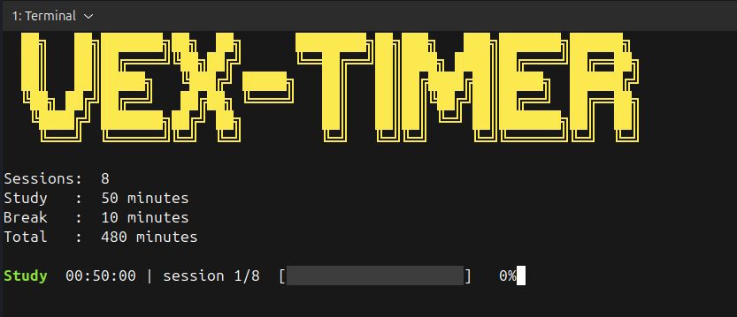

# Vex CLI Study Timer ⏱

<p align="center">
  
</p>

<p align="center">
  <a href="https://github.com/E-Vex/vex-cli-study-timer/releases/latest">
    
  </a>
  <a href="LICENSE">
    
  </a>
  <a href="https://github.com/E-Vex/vex-cli-study-timer/actions/workflows/ci.yml">
    
  </a>
</p>

A small command-line study timer written in C. It schedules focus sessions and
breaks, draws a live progress display, and plays a synthesized chiptune alarm.

Each phase is driven by an absolute monotonic deadline using
`clock_gettime(CLOCK_MONOTONIC)`, so delayed renders or interrupted sleeps do
not make the countdown drift.

## Features

- Configurable study sessions, focus duration, and break duration
- Pause, resume, skip, and quit controls
- Selectable chiptune alarms, with a silent option
- Live countdown, progress bar, and session counter
- Drift-resistant monotonic timing
- Strict CLI parsing with clear error messages and exit codes
- Terminal-bell fallback when `aplay` is unavailable or stdin is not a terminal
- Unit tests (`make test`) and GitHub Actions CI

## Requirements

- A POSIX system with a C11 compiler (Linux is the primary target)
- GCC or Clang and `make`
- `aplay` from `alsa-utils` for sound on Linux (optional)
- A terminal that supports ANSI escape sequences for the live display and
  keyboard controls

CI builds and tests the timer on Linux with GCC and Clang, and on macOS with
Clang. Audio playback uses `aplay`, so sound is Linux-only.

## Build

```bash
make
```

Run `make clean` to remove build artifacts, or `make rebuild` to start fresh.

You can also compile manually:

```bash
gcc -Wall -Wextra -std=c11 -O2 -I. \
  src/main.c src/cli/cli.c src/input/input.c src/timer/counter.c \
  src/timer/timer.c src/timer/print.c src/timer/alarm.c sounds/tone.c \
  -lm -o vex-timer
```

## Usage

```bash
./vex-timer -s 4 -t 25 -b 5
```

| Option | Long form | Description | Range |
| --- | --- | --- | --- |
| `-s` | `--sessions` | Number of study sessions | 1-255 |
| `-t` | `--focus` | Focus duration in minutes | 1-255 |
| `-b` | `--break` | Break duration in minutes | 1-255 |
| `-a` | `--alarm` | Alarm sound (default: `megalovania`) | see below |
| `-h` | `--help` | Show help and exit | - |
| `-v` | `--version` | Show version and exit | - |

`-s`, `-t`, and `-b` are required. Example configurations:

```bash
# Four 25-minute focus sessions with 5-minute breaks
./vex-timer -s 4 -t 25 -b 5

# Same schedule using long options
./vex-timer --sessions 4 --focus 25 --break 5

# Use the Tetris theme for alarms
./vex-timer -s 4 -t 25 -b 5 -a tetris

# A single 50-minute focus session with no sound
./vex-timer -s 1 -t 50 -b 1 -a none
```

For the first example, the timer shows:

```text
Sessions:  4
Study   :  25 minutes
Break   :  5 minutes
Total   :  115 minutes
```

`Total` counts the three breaks between the four sessions, not a break after
the final session.

## Alarm sounds

| Name | Description |
| --- | --- |
| `megalovania` | Default looping chiptune alarm |
| `remix` | Faster Megalovania remix |
| `jazz` | Swing-jazz variation |
| `call-response` | Call-and-response variation |
| `pvz` | Oom-pah style variation |
| `tetris` | Tetris theme |
| `mario` | Mario theme |
| `imperial` | Imperial March |
| `addictive` | Looping melodic hook |
| `beep` | Short three-note beep |
| `hard-to-say-goodbye` | Slower emotional melody |
| `cinematic` | Ambient cinematic track |
| `garden-guardian` | Gentle garden theme |
| `final-showdown` | Epic showdown theme |
| `victory` | Victory fanfare |
| `none` | Silent; also skips the finish fanfare |

In an interactive terminal, phase alarms repeat until a key is pressed. If
`aplay` is unavailable, the timer falls back to the terminal bell. When stdin
is redirected, a single bell is used so the timer can continue unattended.

## Controls

- **Space** or **P** pauses or resumes the current phase.
- **S** skips the current phase. The phase is counted as completed.
- **Q** quits immediately with exit status `130`.
- **Any key** stops a ringing alarm or the finish fanfare.
- **Ctrl+C** quits immediately with exit status `130`.

Controls require an interactive terminal. When stdin is redirected, the timer
still runs but keyboard controls are unavailable and phase alarms use the
terminal bell.

## How It Works

1. `src/cli/cli.c` validates the command-line arguments and builds a
   `timer_config_t`.
2. `src/input/input.c` puts the terminal into non-canonical mode so key presses
   arrive immediately, and restores the previous terminal settings on exit or
   signal.
3. Each focus or break phase stores an absolute `CLOCK_MONOTONIC` deadline.
4. `vext_counter_v2()` calculates the remaining time from the deadline, updates
   the display once per second, and waits for either the next displayed second
   or a key press.
5. Pausing freezes the remaining nanoseconds; resuming rebuilds the deadline
   from that value. Skipping returns control to the state machine immediately.
6. `src/timer/timer.c` runs the study/break state machine until all sessions
   are complete or the user quits.
7. `sounds/tone.c` synthesizes the selected alarm samples and pipes them to
   `aplay`.

## Project Structure

```text
vex-cli-study-timer/
├── .github/
│   └── workflows/
│       └── ci.yml
├── assets/
│   └── demo.png
├── sounds/
│   ├── tone.c
│   └── tone.h
├── src/
│   ├── main.c
│   ├── version.h
│   ├── cli/
│   │   ├── cli.c
│   │   └── cli.h
│   ├── input/
│   │   ├── input.c
│   │   └── input.h
│   └── timer/
│       ├── alarm.c
│       ├── alarm.h
│       ├── counter.c
│       ├── counter.h
│       ├── internals/
│       │   ├── nanosleep_syscall_diagram.txt
│       │   └── syscall_execution_flow.txt
│       ├── print.c
│       ├── print.h
│       ├── timer.c
│       └── timer.h
├── tests/
│   ├── test_cli.c
│   ├── test_main.c
│   ├── test_timer.c
│   └── test_util.h
├── CHANGELOG.md
├── LICENSE
├── Makefile
└── README.md
```

## Testing

```bash
make test
```

The test suite covers strict integer parsing, option validation, alarm-name
validation, timer range checks, and the phase-deadline completion path. CI runs
the same tests on Ubuntu with GCC and Clang and on macOS with Clang.

## Exit Codes

| Code | Meaning |
| --- | --- |
| `0` | Completed successfully, or `--help` / `--version` was used |
| `1` | Invalid arguments or configuration |
| `130` | Interrupted with Ctrl+C or `Q` |
| `128 + signal` | Terminated by another handled signal (for example `143` for `SIGTERM`) |

## Notes

- The timer accepts whole minutes only.
- Skipping a phase counts it as completed, so the finish summary always reports
  the configured number of sessions.
- The timer core is portable POSIX code. Audio playback and the `aplay`
  dependency are Linux-specific.
- The files under `src/timer/internals/` describe the original raw-syscall
  implementation and are kept as reference material.

## License

MIT. See [LICENSE](LICENSE).

Built by [E-Vex](https://github.com/E-Vex).
